# Where every manuscript number comes from, and what `run_all.bat` does

Two things in one place, both derived from the code rather than from memory:

* **Part 1** — every number the manuscript quotes, the table that holds it, and the script
  that writes that table.  All of them are gated (67 checks, see §1.3).
* **Part 2** — the call graph of `run_all.bat`, step by step, with the outputs each step
  produces and what would break if it were skipped.

The authority for Part 1 is `scripts/verify_numbers.py`: it recomputes 67 published numbers
from the packaged tables and fails if any of them moved.  A number that is not among those 67
is marked **ungated** below — that is a real (if small) risk and is listed in §1.3.

---

## Part 1 — number → script → table

### 1.1 The data chain in one picture

```
data/*.csv ──┐
             ├─ hte/v16_core.py (loader + mapping + features) ─→ X, y, split
data/col_mappings.csv ┘
                     │
   scripts/build_*.py │  (each writes exactly the tables listed below)
                     ▼
              results/*.csv, outputs/*.npy
                     │
   scripts/figures_paper2.py  ─→ figures/*.png
   scripts/verify_numbers.py  ─→ PASS/FAIL on 67 numbers
```

### 1.2 The table

| # | Manuscript location | Quantity (example value) | Table holding it | Script that writes the table | Gated? |
|---|---|---|---|---|---|
| 1 | Table 1, every row | `n_rows`, `mean_yield`, `ceiling (se)`, `r2_best`, `capture` | `results/table1_v18_final.csv` | `build_grid_ceiling.py` | ✅ 10 checks |
| 2 | Fig. 1, Fig. 2, §3.1 | 156 grid cells, per-cell R²/RMSE, `capture mean 86.35 %`, `median 87.34 %`, `ρ(ceiling,R²)=+0.709`, `ρ(n_rows,R²)=−0.100` | `results/grid13_v18.csv` + `table1_v18_final.csv` | `build_grid_ceiling.py` | ✅ |
| 3 | §3.1 model comparisons | paired Wilcoxon / BH-adjusted q values | `results/grid_stats.csv` | `build_grid_stats.py` | ✅ 4 checks |
| 4 | Fig. 6, §3.3 enrichment | EF@10 = 93.9 %, EF@50 = 90.9 %, EF@1000 span 1.378–6.872 | `results/enrichment13.csv` | `build_enrichment.py` | ✅ 2 checks |
| 5 | §3.2 confidence intervals | capture 95 % CI `79.4–93.4 %`, median CI `72.0–100.2 %` | `results/bootstrap_ci.csv` | `bootstrap_ci.py` | ✅ 1 check |
| 6 | §3.3 attribution shares | reactant_1 17.34, reactant_2 16.53, temperature 11.19, base 10.54, ligand 8.85, time 7.68, solvent 7.59, catalyst 7.45, additive 3.98, catalyst_eq 2.85 | `results/rebuilt_attrib12_long_v7.csv` | `build_attrib13.py` → `build_attrib_postprocess.py` | ✅ 6 checks |
| 7 | §3.3 first-place counts | 50 / 46 / 30 / 11 of 156 cells, “87 % of the cells” | same table | same | ✅ 4 checks |
| 8 | §3.3 encoding agreement | median ρ = 0.846, median L1 = 27.0 pp, 65 pairs | same table | same | ✅ 3 checks |
| 9 | §3.3 permutation vs SHAP | mean +0.897, median **0.9273**, 156 cells | `results/perm_vs_shap_cells13.csv` | `build_attrib13.py` | ✅ 3 checks |
| 10 | Fig. 3, Fig. 4 | per-feature SHAP distributions and the per-level box plots | `results/attrib13_long.csv` | `build_attrib13.py` | ✅ 2 checks (row and cell counts) |
| 11 | §3.4 held-out paragraph | first pick 95.0 %, random 12.3 %, ceiling 105.0 %, `ρ(σ,\|err\|)=0.115`, coverage 47.3 % | `results/heldout_acquisition.csv`, `results/heldout_calibration.csv` | `build_heldout_acquisition.py` | ✅ 4 checks |
| 12 | §3.4 Bayesian paragraph, Fig. 8 | top prediction 84.1 %, EI pick 56.5 % (rank 21,772), sd 44.6, library median sd 8.9, EI 71.9 % at 100 picks, random 55.5 % | `outputs/acquisition/acq_mu.npy`, `acq_sd.npy`; curves in `results/bo_panel_data.csv` | `build_acquisition.py`, `build_bo_panel.py` | ✅ 1 check (panel row count) |
| 13 | Fig. 5, §3.5 transfer | mean −1.356, range −4.94…−0.12, 48 cells, 48/48 negative | `outputs/c20_transfer_4donor/transfer_matrix.csv`, `results/transfer_check.csv` | `build_transfer.py`, `build_transfer_check.py` | ✅ 5 checks |
| 14 | Fig. 7, §3.5 protocols | +0.7579 random, −0.1515 substrate-disjoint, −0.7994 ordered, drop 0.909 | `results/protocol_cv.csv` | `build_protocols.py` | ✅ 4 checks |
| 15 | Table 2, §3.6 | structural baselines (cond-only / +ECFP / +descriptors / +MACCS / GNN) | `results/graph_baseline.csv` | `build_table2.py` | ✅ 1 check (row count) |
| 16 | §3.6 novel pairs | row R² 0.53–0.63, centred R², pair ρ | `results/novel_pairs.csv` | `build_novel_pairs.py` | ✅ 2 checks |
| 17 | §3.6 unseen reactants | 5,829 unseen reactant-1 rows, R²/MAE/ρ | `results/unseen_reactants.csv` | `build_unseen_reactants.py` | ✅ 2 checks |
| 18 | aggregate ledger (json checks) | the same capture/R²/ρ values re-stated | `outputs/final_numbers/final_numbers_v2.json` | `build_final_numbers.py` | ✅ 6 checks |
| 19 | every figure | the 12 PNGs | `figures/*.png` | `figures_paper2.py` (+ `figures.py` for the backup panel) | synced by `sync_figures_to_docx.py` |
| 20 | §3.4 signed SHAP (Fig. 4) | per-level mean/median signed SHAP, e.g. 6-chloronicotinonitrile +22.5, 6-iodonicotinonitrile −14.3 | `results/panel_signed_shap.csv` | `build_panel_signed_shap.py` | Step 9b |
| 21 | §3.4 ligand x base (Fig. 5) | cell 68.89 %, row mean 16.88 %, column mean 18.72 %, grand 9.63 %, coupling +42.9 | `results/panel_fig5_grid.csv`, `panel_fig5_margins.csv` | `build_panel_fig5_grid.py` | Step 9b |
| 22 | §3.3 last-ranked slot | V1 (row present) 35 / 33 / 24; V2 (positive) 36 / 30 / 19; V3 (zero-filled) base_eq 84 | `results/panel_lastslot.csv`, `panel_lastslot_cells.csv`, `panel_lastslot_meta.csv` | `build_panel_lastslot.py` | Step 9b |
| 23 | §3.1 split stability | test-R² SD 0.007–0.050 on the eleven files >1,000 rows; 0.071 / 0.258 on the two Summit screens | `results/panel_30splits.csv`, `panel_30splits_summary.csv` | `build_panel_30splits.py` | Step 9b |
| 24 | §3.2 both rho intervals | ρ(ceiling,R²) 0.7091 [0.1667, 0.9899]; ρ(rows,R²) −0.1000 [−0.7011, 0.6716]; three sensitivity rows each | `results/rho_ci.csv` | `build_panel_rho_ci.py` (ceiling + size --append) | Step 9b |
| 25 | §3.2 intervals on the 13-dataset corpus | per-dataset ceiling/capture for the 11 datasets with a ceiling (`bh-hte-ood_BH` ceiling 0.657925) plus the `TABLE1_11` aggregate rows | `results/bootstrap_ci13.csv` | `build_bootstrap_ci13.py` | Step 9b |

### 1.3 Known soft spots (stated plainly)

> **Update 2026-10-28 (same day).**  The two soft spots above are closed:
> * the gate now runs **67 checks** (63 + 4 CI checks, covering `grid_stats`,
>   `enrichment13`, `bootstrap_ci`, `protocol_cv`, `graph_baseline`, `novel_pairs`,
>   `unseen_reactants`, `bo_panel_data` and `attrib13_long`), so "ungated" no longer
>   applies to any table in §1.2;
> * `outputs/final_numbers/final_numbers_v2.json` now has a producer,
>   `scripts/build_final_numbers.py`, which derives every value from
>   `table1_v18_final.csv` and `grid13_v18.csv`; it runs just before the gate.


| Issue | Consequence | Fix if wanted |
|---|---|---|
| ~~8 of the 19 sources were not gated~~ | **closed 2026-10-28**: 19 checks added, the gate now runs **67** | — |
| ~~`final_numbers_v2.json` had no producer~~ | **closed 2026-10-28**: `build_final_numbers.py` derives it from Table 1 + the grid, and runs before the gate | — |
| §3.4's two paragraphs use **different σ** definitions? | **No** — both use the five-architecture panel spread since v3.43 | — |
| the gate's total was hard-coded (`len(fails) + 44`) | **closed**: every check counts itself, so adding one can never leave the reported total stale | — |

---

## Part 2 — what `run_all.bat` does

Eleven steps, ~27 minutes warm (~40 cold).  `run_all_except_VirtualLibrary.bat` is the same
without step 8.  Both are safe to leave unattended (`DSH_NO_PAUSE=1` skips the final `pause`).

```mermaid
flowchart TD
    A[run_all.bat] --> S1

    S1["<b>Step 1</b> build_grid_ceiling.py<br/>13 datasets x 12 model/encoding cells,<br/>noise ceiling, Table 1"]
    S1 --> O1[("results/grid13_v18.csv<br/>results/table1_v18_final.csv<br/>results/dataset_index.csv")]
    O1 --> S2

    S2["<b>Step 2</b> build_grid_stats.py<br/>paired model comparisons, BH q"]
    S2 --> O2[("results/grid_stats.csv")]
    O2 --> S3

    S3["<b>Step 3</b> build_enrichment.py<br/>cross-fitted ranking vs random"]
    S3 --> O3[("results/enrichment13.csv")]
    O3 --> S4

    S4["<b>Step 4</b> build_transfer.py +<br/>build_transfer_check.py<br/>4 donors x 12 targets"]
    S4 --> O4[("outputs/c20_transfer_4donor/<br/>transfer_matrix.csv<br/>results/transfer_check.csv")]
    O4 --> S5

    S5["<b>Step 5</b> build_protocols.py<br/>random / substrate-disjoint / ordered<br/>(32 threads)"]
    S5 --> O5[("results/protocol_cv.csv")]
    O5 --> S6

    S6["<b>Step 6</b> build_table2.py<br/>structural baselines on the datasets<br/>flagged structure:true"]
    S6 --> O6[("results/graph_baseline.csv")]
    O6 --> S7

    S7["<b>Step 7</b> build_novel_pairs.py +<br/>build_unseen_reactants.py<br/>section 3.6 extrapolation"]
    S7 --> O7[("results/novel_pairs.csv<br/>results/unseen_reactants.csv")]
    O7 --> S8

    S8["<b>Step 8</b> build_acquisition.py +<br/>build_bo_panel.py +<br/>build_heldout_acquisition.py<br/>virtual library, BO panels,<br/>held-out real chemistry"]
    S8 --> O8[("outputs/acquisition/acq_mu.npy<br/>acq_sd.npy<br/>results/bo_panel_data.csv<br/>results/heldout_*.csv")]
    O8 --> S9

    S9["<b>Step 9</b> build_attrib13.py +<br/>build_attrib_postprocess.py +<br/>build_attrib_flags.py<br/>156 cells x (SHAP + permutation),<br/>~18 min, 70 % of the whole run"]
    S9 --> O9[("results/attrib13_long.csv<br/>results/perm_vs_shap13.csv<br/>perm_vs_shap_cells13.csv<br/>rebuilt_attrib12_long_v7.csv<br/>attrib13_long_cosolvent_flagged.csv")]
    O9 --> S10

    S10["<b>Step 10</b> figures_paper2.py +<br/>figures.py (backup panel)<br/>renders the 12 manuscript panels"]
    S10 --> O10[("figures/fig1a … fig8b_mu_sd.png<br/>+ fig8b_backup_loading.png")]
    O10 --> S11

    S10b["<b>Step 10b</b> build_final_numbers.py<br/>derives the aggregate ledger<br/>from Table 1 + the grid"]
    S10b --> O10b[("outputs/final_numbers/<br/>final_numbers_v2.json")]
    O10b --> S11
    S11["<b>Step 11</b> verify_numbers.py<br/>recomputes 67 published numbers<br/>from the tables above"]
    S11 --> OK{all 67 match?}
    OK -->|yes| DONE["ALL DONE<br/>tables in results\\, figures in figures\\"]
    OK -->|no| FAIL["FAILED — prints the offending checks"]
```



### Step-by-step commentary

| Step | Why it must run before the next one | Runtime |
|---|---|---|
| 1 | everything downstream quotes Table 1 or the grid | ~1 s warm / 8–10 min cold |
| 2 | needs the finished grid | 2 s |
| 3 | needs Table 1 (the captured R² per dataset) | 29 s |
| 4 | needs Table 1 (means, n_rows) | 59 s |
| 5 | independent, but figures.py reads its table | 3 s warm / ~3 min cold |
| 6 | needs Table 1 for the reference cell | 3 min |
| 7 | independent | 1 min 50 s |
| 8 | needs the case-study dataset only | 1 min 33 s |
| 9 | trains 156 models; nothing else depends on it except figures 3/4 and the §3.3 numbers | **18 min** |
| 10 | reads every table above | 1 min |
| 10b | derives `final_numbers_v2.json` from Table 1 and the grid | <1 s |
| 11 | reads every table above and recomputes the **67** numbers | 5 s |

### What each step would break if removed

| Removed step | What silently disappears |
|---|---|
| 1 | Table 1, Fig. 1, Fig. 2, §3.1, §3.2 — and step 11 cannot run at all |
| 2 | §3.1's significance statements |
| 3 | Fig. 6 and the enrichment numbers |
| 4 | Fig. 5's fourth bar and §3.5 |
| 5 | Fig. 7 and the protocol bars |
| 6 | Table 2 |
| 7 | §3.6 |
| 8 | Fig. 8 and both §3.4 paragraphs |
| 9 | Fig. 3, Fig. 4, §3.3, and six of the gate's checks |
| 10 | every figure (the manuscript would keep the last rendered bytes) |
| 11 | the only automatic proof that the numbers above still match the manuscript |
